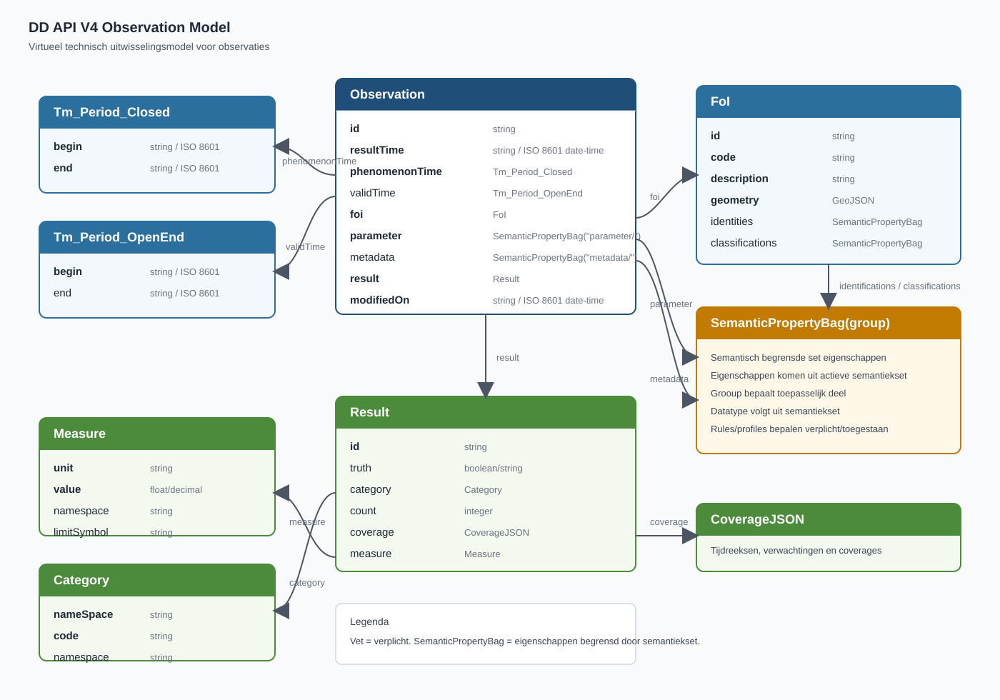

# **Virtuele** Datamodellen (Observation)

<aside class="advisement" title="Work-in-progress">
De specificatie is nog in ontwikkeling. Tot deze finaal is, zal de specificatie nog kunnen veranderen.
De principes staan echter vast. 

Specificaties van de onderliggende semantiek (eigenschappen die mogen worden gebruikt in de API)
kunnen los van deze (technische) specificatie veranderen. Die informatie is te vinden in de folders /definitions/<domein>/<yyyyMMdd>.
</aside>

<aside class="advisement" title="Virtueel model">
De modellen in dit hoofdstuk zijn virtueel. 
Ze beschrijven uitsluitend de structuur van de data zoals deze door de API wordt uitgewisseld. 
Een implementatie hoeft deze structuur intern niet als opslagmodel te gebruiken; de aanbieder is vrij in de keuze van database-technologie en mapt de eigen bronnen on-the-fly naar dit virtuele model.
</aside>

Dit hoofdstuk beschrijft het datamodel van DD API V4, gebaseerd op een subset van de OGC [[OM&S]] standaard.
De casing van de eigenschappen volgen in V4 de JSON-camelCase conventie.

Dit beschrijft de JSON-representatie van een observatie.

Het formaat dat DD API V4 gebruikt is een **technisch uitwisselingsformaat** in JSON encoding, met JSON Schema als normatieve specificatie. 
Dit betreft niveau 4 (fysiek/technisch datamodel) volgens het MIM-lagenmodel, wat expliciet buiten de scope van MIM valt. 
MIM is bedoeld voor conceptuele en logische informatiemodellen (niveau 1-3), niet voor REST API-berichtformaten.

Vet is verplicht.

## Observation
Observation beschrijft de omstandigheden en de resultaten van een observatie.

| Eigenschap         | Type                                                               | Omschrijving                                                                                                                                        |
|--------------------|--------------------------------------------------------------------|-----------------------------------------------------------------------------------------------------------------------------------------------------|
| **id**             | Edm.String                                                         | Unieke id van de observatie. Aangepast met casing t.o.v. V3                                                                                         |
| **resultTime**     | Edm.String                                                         | Datum en tijd waarop het resultaat beschikbaar is gekomen, in ISO8601 formaat. Het geeft aan wanneer het resultaat is opgenomen in het bronsysteem. |
| **type**           | Edm.String                                                         | Beschrijft het type van `result`. Mogelijke waarden zijn: count, measure, truth, category, coverage.                                                |
| **phenomenonTime** | [Tm_Period](#Tm_Period_Closed)                                     | Periode waarin is gemeten/bemonsterd. Begin- en EndPosition zijn in ISO8601 formaat.                                                                |
| validTime          | [Tm_Period](#Tm_Period_OpenEnd)                                    | Geldigheidsperiode van de data.                                                                                                                     |
| **foi**            | [FoI](#FoI)                                                        | Feature of Interest: altijd geolocatie van de observatie. Geeft aan _waar_ gemeten is.                                                              |
| **parameter**      | [SemanticPropertyBag("parameter")](06-00-semantic-property-bag.md) | Beschrijft de omstandigheden van de observatie: _wat_ en _waarmee_ er gemeten is.                                                                   |
| metadata           | [SemanticPropertyBag("metadata")](06-00-semantic-property-bag.md)  | Extra informatie over de observatie, ongeklassificeerd, zoals ordernummer.                                                                          |
| **result**         | [Result](#result)                                                  | Resultaat: de _uitkomst_ van de observatie.                                                                                                         |
| **modifiedOn**     | Edm.String                                                         | Datum creatie of laatste wijziging in ISO8601 date-time formaat.                                                                                    | 

## Tm_Period_Closed

Beschrijft een periode met begin- en einddatum. Beide waarden zijn verplicht. De naamgeving is aangepast t.o.v. V4 en is meer in lijn met SensorThings API.

| Eigenschap | Type   | Omschrijving                                       |
|------------|--------|----------------------------------------------------|
| **begin**  | string | Begin van de periode in ISO8601 date-time formaat. |
| **end**    | string | Eind van de periode in ISO8601 date-time formaat.  |

## Tm_Period_OpenEnd

Beschrijft een periode met begin- en einddatum. Einddatum is niet verplicht. De naamgeving is aangepast t.o.v. V4 en is meer in lijn met SensorThings API.

| Eigenschap | Type   | Omschrijving                                       |
|------------|--------|----------------------------------------------------|
| **begin**  | string | Begin van de periode in ISO8601 date-time formaat. |
| end        | string | Eind van de periode in ISO8601 date-time formaat.  |

## FoI

FoI (Feature of Interest) is in DD API V3/V4 altijd een geolocatie.

| Eigenschap      | Type                                                                                      | Omschrijving                                                  |
|-----------------|-------------------------------------------------------------------------------------------|---------------------------------------------------------------|
| **id**          | Edm.String                                                                                | Uniek id van de meetlocatie. Aangepast met casing t.o.v. V3   |
| **code**        | Edm.String                                                                                | Code van de meetlocatie.                                      |
| **description** | Edm.String                                                                                | Beschrijving van de meetlocatie.                              |
| **geometry**    | Edm.Geometry                                                                              | GeoJSON behorende bij de meetlocatie. Hernoemd naar geometry. |
| identities      | [SemanticPropertyBag("foiIdentitiesForObservation")](06-00-semantic-property-bag.md)      | Identities van het meetobject in andere systemen.             |
| classifications | [SemanticPropertyBag("foiClassificationsForObservation")](06-00-semantic-property-bag.md) | Classificaties van het meetobject in andere systemen.         |
| networks        | Collection(Edm.String)                                                                    | Netwerken waar het meetobject bij hoort.                      |

> De FoI binnen een Observation wordt als ComplexType opgenomen; `/v4/odata/foi` is de OData-collectie voor meetobjecten.

## Parameter

Parameter volgens [[OM&S]] is een dictionary van key/value pairs.

In DD API V4 is value altijd een string, waarbij geldt dat de combinatie van key en value uniek is per observatie,
maar ook dat die combinatie **zoveel mogelijk** overeenkomt met de Aquo-termen, maar die combinatie moet ook voorkomen 
in de data in het parameter-endpoint.

De keys moeten altijd conform de specifieke semantiek (semantics.csv) zijn en beginnen met `parameter/`.

## Metadata

Metadata bevat alle extra informatie over de observatie, die niet gestandaardiseerd is, zoals ordernummer van een opdracht.

De keys moeten altijd conform de specifieke semantiek (semantics.csv) zijn en beginnen met `metadata/`.

## Result

Result is het resultaat van een observatie.

Het formaat van Result is afhankelijk van het type van de observatie.  

| Eigenschap | Type                  | Omschrijving                                                                              |
|------------|-----------------------|-------------------------------------------------------------------------------------------|
| **id**     | Edm.String            | Uniek Id van het resultaat (_mag_ gelijk zijn aan het Id van de observatie).              |
| _truth_    | Edm.String            | Wanneer het resultaat een waarheid representeert (waar/onwaar, true/false).               |
| _category_ | [Category](#category) | Wanneer het een `typering` volgens Aquo betreft.                                          |
| _count_    | Edm.Int64             | Pure 'telling', bijvoorbeeld onder een microscoop, altijd een heel getal, zonder eenheid. |
| _coverage_ | [[CoverageJSON]]      | Tijdreeksen of verwachtingen.                                                             |
| _measure_  | [Measure](#measure)   | Waarde/eenheid combinatie.                                                                |

#### Hulp bij interpretatie voor IM Metingen

IM Metingen hanteert een andere terminologie dan [[OM&S]]. Waar IM Metingen specifieke velden heeft voor typering en 
grootheid (en alfanumerieke waarde), zijn dat in [[OM&S]] verschillende soorten Result.  

##### Wanneer het een Aquo `Typering` betreft

Gebruik type [Category](#category). De `namespace` (woordenlijst) daarin wordt dan gelijk aan de code van de typering 
en `code` (woord) wordt gelijk aan de alfanumerieke waarde die binnen die typering gebruikt kan worden.

##### Wanneer het een Aquo `Grootheid` betreft

- Wanneer het een fysieke telling betreft (dus gehele getallen), dan _mag_ het type `Count` worden gebruikt. Dit impliceert dat de eenheid volgens Aquo termen `N` (Aantal) is.
- Gebruik anders type [Measure](#measure).

## Measure

Gemeten waarde met eenheid.

| Eigenschap  | Type       | Omschrijving                                                |
|-------------|------------|-------------------------------------------------------------|
| **unit**    | Edm.String | Eenheid van de observatie. Waar mogelijk, een Aquo eenheid. |
| **value**   | Edm.Double | Waarde van de observatie.                                   |
| namespace   | Edm.String | Bron voor de definitie. Indien leeg, Aquo.                  |
| limitSymbol | Edm.String | Limietsymbool.                                              |

## Category

Onderwerp/waarde combinatie (classificatie).

| Eigenschap    | Type       | Omschrijving                      |
|---------------|------------|-----------------------------------|
| **namespace** | Edm.String | Domeintabel.                      |
| **code**      | Edm.String | Domeinwaarde binnen de namespace. |

## CoverageJSON

Voor tijdreeksen wordt gebruik gemaakt van [[CoverageJSON]] formaat.
Voor DD API V4 worden aan het implementeren van correcte CoverageJSON de volgende eisen gesteld:

- Voor sensoren wordt aangeraden om een tijdreeks te hebben met de naam van een Aquo waarnemingssoort.
  Dit zorgt ervoor dat eenvoudig een selectie kan plaatsvinden.
- phenomenonTime/begin en phenomenonTime/end moeten overeenkomen met het datum-bereik van tenminste één van de tijdreeksen.
- modifiedOn **moet** overeenkomen met de laatste wijzigingsdatum van de data.

## DD API V4 Observation UML

<figure>
<figcaption>DD API V4 Observation Model - Illustratief diagram</figcaption>
</figure>

